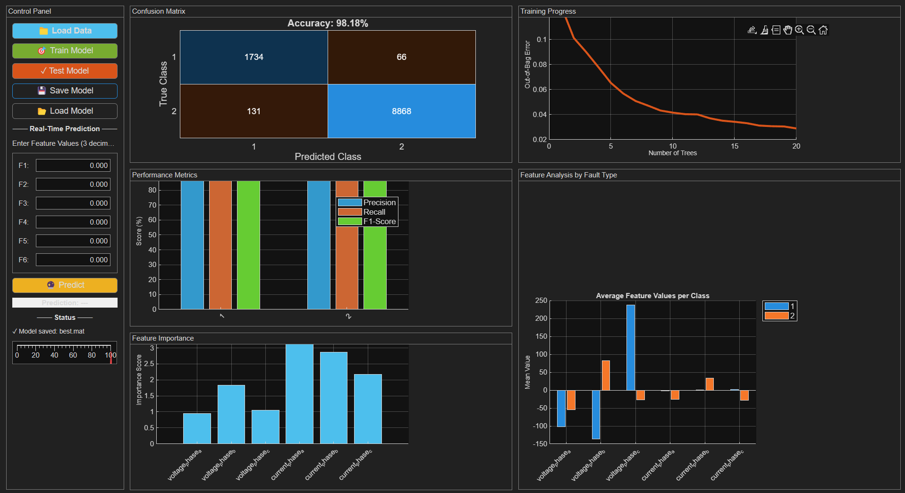

# Fault Detection & Classification in Power Line using Random Forest (MATLAB)

An interactive MATLAB app that detects and classifies faults on transmission lines using a **Random Forest** (`TreeBagger`) classifier. The whole workflow, from loading data to training, testing, saving the model and predicting on live inputs, runs through a single GUI built with `uifigure`.

---

## Features

- **Multi-file data loading**: select one or several CSV files and they are merged automatically
- **Clean preprocessing**: missing-value removal and z-score normalisation
- **Stratified 70/30 train-test split**, with normalisation statistics computed from the training set only (no data leakage)
- **Random Forest training** with out-of-bag (OOB) error tracking
- **Evaluation dashboard**:
  - Confusion matrix with overall accuracy
  - Per-class Precision / Recall / F1-score
  - Feature importance ranking (OOB permuted predictor importance)
  - Average feature values per fault class
- **Real-time prediction**: enter 6 feature values and get an instant *Normal* / *Fault Detected* result
- **Save / load models** as `.mat` files (includes normalisation parameters)

---

## Repository Structure

```
.
├── Project.mlx                 
├── Dataset.txt
├── Output.png
└── README.md
```

The dataset covers four transmission line scenarios (TL 1 to TL 4), each with a *fault detection* file (is there a fault?) and a *fault classification* file (what type of fault is it?). `merged_dataset.csv` combines the files into one.

---

## Requirements

- MATLAB (R2020b or later recommended, for `uifigure`, `uigridlayout`, `confusionchart`)
- **Statistics and Machine Learning Toolbox** (`TreeBagger`, `cvpartition`, `confusionmat`)

---

## How to Run

1. Clone the repository:
   ```bash
   git clone https://github.com/<your-username>/<repo-name>.git
   cd <repo-name>
   ```
2. Open `Project.mlx` in MATLAB and click **Run**. The *Fault Detection System* window will open.
3. Use the **Control Panel** on the left:

   | Step | Button | What it does |
   |------|--------|--------------|
   | 1 | 📁 Load Data | Pick one or more CSVs from the `Dataset/` folder |
   | 2 | 🎯 Train Model | Trains the Random Forest and plots OOB error and feature importance |
   | 3 | ✓ Test Model | Evaluates on the held-out 30% and shows the confusion matrix and metrics |
   | 4 | 💾 Save Model | Saves the model and normalisation parameters to a `.mat` file |
   | 5 | 📂 Load Model | Reloads a saved model without retraining |
   | 6 | 🔮 Predict | Classifies a single sample from the feature values `F1` to `F6` |

> **Tip:** Load detection files and classification files separately. They have different label sets, so don't mix them in one training run.

---

## Data Format

Each CSV is expected to have:

- **Columns 1 to 6**: numeric input features (shown as `F1` to `F6` in the prediction panel)
- **Column 7**: the class label

Rows with missing values are dropped on load.

---

## Method

1. **Load and merge** the selected CSV files
2. **Clean** by removing rows with missing values
3. **Split** 70% train / 30% test, stratified by class (`cvpartition` hold-out)
4. **Normalise** with z-score, using the training mean and standard deviation only; constant features are guarded against division by zero
5. **Train** a `TreeBagger` Random Forest:
   - 20 trees
   - `MinLeafSize = 500`
   - OOB prediction and OOB predictor importance enabled
6. **Evaluate** with accuracy, confusion matrix, and per-class precision, recall and F1

---

## Results

| Metric | Value |
|--------|-------|
| Test accuracy | _98.18 %_ |
| Average F1-score | _96.76 %_ |



---
